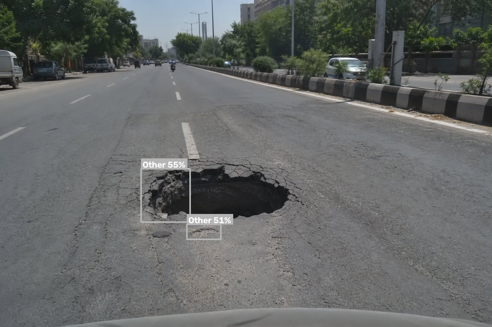

# RoadGuard AI — Intelligent Road Damage Detection & Monitoring Platform

[](https://yashpanchal22.github.io/roadguard-ai/)
[](https://codespaces.new/YashPanchal22/roadguard-ai)
[](https://www.python.org/)
[](https://fastapi.tiangolo.com/)
[](https://ultralytics.com)
[](https://react.dev)
[](https://www.typescriptlang.org/)

RoadGuard AI is a working full-stack platform for reporting road damage, running real
YOLO object detection on uploaded photographs, placing reports on an interactive map,
prioritising repairs with an explainable score, and tracking each report from submission
to resolution.

It is built as a B.Sc. Data Science final-year project that can be demonstrated end-to-end
**and** extended into a municipal pilot: persistent database, role-gated review workflow,
audit trail, exports and a documented model training/evaluation path.

> **Honesty charter.** Every detection comes from a real model run. Every KPI, chart and
> export is computed from database rows. Model metrics are only shown when a real
> evaluation has been imported. Missing weights produce an explicit error, never
> fabricated predictions. Demo data is flagged `DEMO` everywhere, including exports.

---

## 🚀 Live Demo & Deployment

### 🌐 Live Web Demo on GitHub Pages
* **URL:** **[https://yashpanchal22.github.io/roadguard-ai/](https://yashpanchal22.github.io/roadguard-ai/)**
* **Automated CI/CD:** Powered by GitHub Actions (`.github/workflows/deploy-pages.yml`).
* **Activation:** In your GitHub repo settings, go to **Settings → Pages → Source** and select **GitHub Actions**. Every push to `main` deploys the web app automatically.

### ⚡ 1-Click Full-Stack Launch on GitHub Codespaces
Click the **Open in GitHub Codespaces** badge or go to **Code → Codespaces → Create codespace on main**. GitHub launches a full cloud container running both the Python AI model (PyTorch YOLOv8) and React frontend with zero local configuration.

### Real AI Inference Output (CPU YOLOv8s)
The platform performs real-time distress localization and categorization across 5 distress classes (*Pothole, Longitudinal Crack, Transverse Crack, Alligator Crack, Other*):

| Input Road Photo | Real-Time YOLO Bounding Boxes & Confidence |
|:---:|:---:|
|  |  |
| *Urban roadway distress input* | *Real YOLOv8 detection: distress boxes with confidence scores* |

### Pre-Configured Demo Credentials for Evaluators
| Role | Email | Password | Access Highlights |
|---|---|---|---|
| **Citizen** | `citizen@demo.local` | `Citizen#2024` | Photo upload, GPS pinning, real-time YOLO bounding box visualization |
| **Reviewer** | `reviewer@demo.local` | `Reviewer#2024` | Review workflow queue, duplicate candidate matching, audit history |
| **Admin** | `admin@demo.local` | `Admin#2024` | 8-chart analytics dashboard, explainable priority scoring, CSV/JSON/PDF exports |

---

## 1. What actually works

| Capability | Status |
|---|---|
| Image upload with extension/MIME/magic-byte/size/integrity validation | ✅ implemented + tested |
| Real YOLO inference (5 road-distress classes, CPU) | ✅ runs (measured ≈210–250 ms/photo on this box) |
| Annotated image output (boxes + labels + confidence) | ✅ implemented + tested |
| Report submission with GPS **or** manual map pin | ✅ implemented + tested |
| Persistent reports, images, detections, repair updates, audit logs | ✅ SQLite, survives restart (tested) |
| Leaflet + OpenStreetMap map with severity/status markers, bounds loading, filters | ✅ implemented |
| Report lifecycle (`submitted → … → resolved`, `rejected`) with history | ✅ implemented + tested |
| Explainable priority scoring (6 factors, per-factor contribution) | ✅ implemented + tested |
| Duplicate assistance (distance + time + category + perceptual hash) with audited linking | ✅ implemented + tested |
| Dashboard KPIs + 8 charts from live records, honest empty states | ✅ implemented + tested |
| CSV / JSON / PDF exports of the filtered query | ✅ implemented + tested |
| Role-based access (citizen / reviewer / admin) with JWT + PBKDF2 | ✅ implemented + tested |
| Synthetic demo dataset (≥100 reports, lifecycle histories, demo credentials) | ✅ generated (120) |
| Training / evaluation / import scripts + dataset guide | ✅ scripts written, **not executed** (no annotated dataset here) |
| Local model accuracy metrics | ❌ not measured — page shows "Evaluation not yet available" |
| Browser screenshot verification | ❌ not possible in this sandbox (see §10) |

---

## 2. Quick start

### Prerequisites
* Python 3.11 – 3.13
* Node.js 18+ (20 LTS tested)
* ~2 GB free disk (PyTorch + model weights)

### 2.1 Backend

```bash
cd roadguard-ai
python3 -m venv .venv && source .venv/bin/activate      # optional but recommended
pip install torch==2.6.0 torchvision==0.21.0 --index-url https://download.pytorch.org/whl/cpu
pip install -r backend/requirements.txt

cp .env.example .env                                     # then edit ROADGUARD_JWT_SECRET
cd backend && python -m uvicorn app.main:app --host 0.0.0.0 --port 8000 --reload
```

* API docs (Swagger): <http://localhost:8000/api/docs>
* Health: <http://localhost:8000/api/v1/health>

On first start the app creates the SQLite database, seeds 120 clearly-labelled demo
reports (if `ROADGUARD_SEED_DEMO_ON_STARTUP=true`) and loads the model once.

### 2.2 Frontend

```bash
cd roadguard-ai/frontend
npm install
npm run dev            # http://localhost:5173  (proxies /api → :8000)
```

For a single-server deployment, build the SPA and let FastAPI serve it:

```bash
cd frontend && npm run build     # → frontend/dist
# restart uvicorn, then open http://localhost:8000
```

### 2.3 Demo accounts (development seed only)

| Role | Email | Password |
|---|---|---|
| Reviewer | `reviewer@roadguard.demo` | `Reviewer@123` |
| Administrator | `admin@roadguard.demo` | `Admin@123` |

These accounts are created **only** by the demo seed script. Delete or change them before
any real deployment (`python -m app.services.demo_data --purge` removes demo reports;
remove the users in SQL or skip seeding in production with
`ROADGUARD_SEED_DEMO_ON_STARTUP=false`).

### 2.4 Model weights

The repository expects `data/models/pothole_yolov8.pt`
(Apache-2.0 community YOLOv8s road-distress checkpoint: classes *Longitudinal Crack,
Transverse Crack, Alligator Crack, Pothole, Other*).

```bash
curl -L -o data/models/pothole_yolov8.pt \
  https://huggingface.co/vinothvikas1987/pothole-detection-yolov8/resolve/main/best.pt
```

No weights? The API stays up, `/detection/analyze` returns **HTTP 503 `MODEL_UNAVAILABLE`**
with setup hints, and the UI shows the same instructions. Nothing is simulated.
To train your own, see **[docs/MODEL_GUIDE.md](docs/MODEL_GUIDE.md)**.

---

## 3. Project layout

```
roadguard-ai/
├── backend/
│   ├── app/
│   │   ├── api/routes/        auth, detection, reports, map_routes, analytics,
│   │   │                      model_routes, exports, meta
│   │   ├── core/              config, security (PBKDF2+JWT), errors, rate_limit
│   │   ├── database/          base, session, init_db (additive migrations)
│   │   ├── models/            SQLAlchemy entities
│   │   ├── schemas/           Pydantic request/response models
│   │   ├── services/          reports lifecycle, priority, duplicates, storage,
│   │   │                      serializers, exports, demo_data
│   │   ├── analytics/         metrics (KPIs, chart aggregates)
│   │   ├── detection/         detector (YOLO singleton), validation (upload guards)
│   │   └── main.py            app factory, error envelope, SPA serving
│   ├── tests/                 54 pytest tests
│   └── requirements.txt
├── frontend/
│   └── src/
│       ├── components/        ui primitives, charts, MapView, FilterBar,
│       │                      ReportDetailPanel, badges
│       ├── context/           theme, auth, toast, meta providers
│       ├── hooks/             useAsync, useDebounced, useGeolocation, useFilters
│       ├── layouts/           AppLayout (collapsible sidebar, theme toggle)
│       ├── pages/             10 screens + login
│       ├── services/          axios client, typed endpoints
│       ├── test/              vitest + RTL suites (25 tests + 5 live API)
│       └── types/             shared TypeScript contracts
├── ml/
│   ├── training/              config.yaml, train.py
│   ├── evaluation/            evaluate.py, import_results.py
│   └── scripts/               predict.py, benchmark_latency.py
├── data/
│   ├── samples/               3 road photographs for demos (synthetic, generated)
│   ├── models/                weight file (gitignored)
│   ├── uploads/               runtime storage (gitignored)
│   └── dataset/               YOLO dataset skeleton + data.yaml
├── docs/                      MODEL_GUIDE, DEPLOYMENT, PRIORITY, API, TESTING,
│                              ARCHITECTURE, task-contract.json
├── .env.example
├── Makefile
└── README.md
```

Deviations from the requested tree are documented in
[docs/ARCHITECTURE.md](docs/ARCHITECTURE.md) (e.g. `api/routes/` split, `analytics/`
holding pure aggregation functions, `services/` for domain logic).

---

## 4. Main navigation

| # | Screen | Route | Purpose |
|---|---|---|---|
| 1 | Overview dashboard | `/` | 8 live KPI cards, 8 charts, priority queue, filters |
| 2 | Report road damage | `/report` | upload → detect → confirm → pick location → submit |
| 3 | AI detection results | `/detection` | real inference, boxes, labels, confidence, latency |
| 4 | Live damage map | `/map` | Leaflet map, bounds loading, synchronised list |
| 5 | All reports | `/reports` | search/sort/filter/paginate, detail drawer |
| 6 | Repair management | `/repairs` | board by lifecycle stage + priority queue |
| 7 | Data analytics | `/analytics` | distributions, trends, regional table |
| 8 | Model performance | `/model` | classes, thresholds, evaluation state, limitations |
| 9 | Reports & exports | `/exports` | CSV / JSON / PDF from the filtered query |
| 10 | Settings | `/settings` | theme, account, priority weights, env reference |

---

## 5. API surface (prefix `/api/v1`)

```
POST   /auth/register                       citizen self-registration (role forced)
POST   /auth/login                          → JWT bearer token
GET    /auth/me

POST   /detection/analyze                   multipart upload → real inference
GET    /detection/analysis/{id}/{variant}   temporary original/annotated image
GET    /detection/analysis/{id}             stored analysis metadata

POST   /reports                             create (optional analysis_id)
GET    /reports                             q, status[], category[], severity[],
                                            date_from/to, bbox, min_priority, geo_only,
                                            include_synthetic, sort, order, page, page_size
GET    /reports/{id|reference}
PATCH  /reports/{id}                        reviewer/admin only
POST   /reports/{id}/status                 lifecycle transition + repair update
GET    /reports/{id}/history                repair updates + audit trail
GET    /reports/{id}/duplicates             advisory candidates + existing links
POST   /reports/{id}/duplicates/link        reviewer/admin, audited
GET    /reports/{id}/priority               factor-by-factor explanation
DELETE /reports/{id}                        admin only

GET    /map/reports?south&west&north&east   bounds query (valid coordinates only)
GET    /map/config                          centre, tile URL, policy note

GET    /analytics/overview                  KPI cards
GET    /analytics/charts                    all chart bundles
GET    /analytics/regions                   per-ward aggregates
GET    /analytics/priority-queue            ranked verified cases with factors
GET    /analytics/recompute                 reviewer/admin

GET    /model/info                          loaded model + provenance
GET    /model/evaluation                    real metrics or honest empty state
POST   /model/reload                        admin

GET    /exports/reports.csv
GET    /exports/reports.json
GET    /exports/summary.pdf

GET    /settings/priority                   current weights/thresholds
PUT    /settings/priority                   admin (runtime override + recompute)
GET    /meta/options                        enumerations + allowed transitions
GET    /health
GET    /media/reports/{image_id}/{variant}  traversal-safe file serving
```

Error envelope (every failure):

```json
{ "error": { "code": "MODEL_UNAVAILABLE", "message": "…", "details": {…}, "hints": ["…"] } }
```

---

## 6. Configuration

All settings are environment variables (prefix `ROADGUARD_`), documented in `.env.example`.
Nothing is hardcoded. Key ones:

| Variable | Default | Meaning |
|---|---|---|
| `ROADGUARD_DATABASE_URL` | `sqlite:///./data/roadguard.db` | SQLAlchemy URL (PostgreSQL supported) |
| `ROADGUARD_MODEL_PATH` | `./data/models/pothole_yolov8.pt` | weight file |
| `ROADGUARD_CONF_THRESHOLD` / `_IOU_THRESHOLD` | `0.35` / `0.45` | inference thresholds |
| `ROADGUARD_DEVICE` | `cpu` | `cpu` or `cuda` |
| `ROADGUARD_MAX_UPLOAD_MB` | `10` | upload cap |
| `ROADGUARD_JWT_SECRET` | dev placeholder | **must** be replaced in production |
| `ROADGUARD_CORS_ORIGINS` | localhost dev origins | comma separated list |
| `ROADGUARD_SEED_DEMO_ON_STARTUP` | `true` | seed demo data when the DB has none |
| `ROADGUARD_DEMO_REPORT_COUNT` | `120` | demo report count |

---

## 7. Demo data

```bash
cd backend
python -m app.services.demo_data --count 120      # regenerate demo rows
python -m app.services.demo_data --purge          # delete ONLY synthetic rows
```

* Every generated record has `is_synthetic = true` and a `DEMO` badge in the UI and exports.
* Coordinates are plausible jittered positions around Ahmedabad wards — labels for a
  demonstration, not claims about real damage.
* Lifecycle histories (verification, assignment, repair, resolution) are realistic and
  timestamped.
* Three photographs in `data/samples/` are attached to a handful of demo reports. Any
  detections stored for them come from an **actual model run** on those files; they remain
  flagged synthetic because their parent report is synthetic.
* Real user submissions are never touched by `--purge`.

---

## 8. Security & privacy summary

* Upload checks: extension, declared MIME, magic bytes, extension/content agreement,
  Pillow `verify()` integrity, min/max dimensions, decompression-bomb guard, size cap.
* Generated filenames are UUID-based; all file access resolves inside the storage root
  (path-traversal requests return 404, covered by a regression test).
* Passwords: PBKDF2-HMAC-SHA256, 260 000 rounds, per-user salt. Tokens: signed JWT.
* Role checks are enforced server-side on every mutating route (`reviewer`, `admin`).
* SQLAlchemy parameterised queries only; CORS configurable; secrets from env.
* Rate limiting on `/detection/analyze`, `/reports` (create) and `/auth/*`
  (in-process — put limits at the proxy for multi-worker deployments).
* Uploaded photographs are **re-encoded** on save, which strips EXIF (including GPS).
  The API reports whether EXIF GPS was present but never trusts or stores it.
* Reporter identity is excluded from exports unless an admin requests it.
* No private filesystem paths are exposed by the API (only the weight *file name*).

Details: [docs/DEPLOYMENT.md](docs/DEPLOYMENT.md).

---

## 9. Testing

```bash
# backend — 54 tests
cd backend && python -m pytest

# frontend unit/component — 25 tests
cd frontend && npm run test

# frontend ↔ live API integration — 5 tests (needs the API on :8000)
cd frontend && RUN_LIVE_TESTS=1 npx vitest run src/test/live-api.test.tsx

# type check + production build
cd frontend && npm run build
```

Recorded results (this environment, 2026-10-25):

```
backend : 54 passed in 6.73s
frontend: 25 passed (5 files) + 5 live-API tests (opt-in)
live API: 5 passed
build   : tsc -b clean, vite build → dist/assets/index-*.js 954 kB (gzip 271 kB)
ruff    : All checks passed!
```

Full evidence, coverage notes and known gaps: [docs/TESTING.md](docs/TESTING.md).

---

## 10. Known limitations (read before presenting)

1. **No local accuracy metrics.** The bundled weights are community weights; their model
   card reports mAP50 0.629 / mAP50-95 0.345 on *their* split. Those numbers are **not**
   reproduced here as if measured locally. The Model performance page shows
   *"Evaluation not yet available"* until you run `ml/evaluation/evaluate.py` on your own
   annotated test split and import the artefact.
2. **Model scope.** It recognises the five trained classes only. It was not trained on
   night, rain or extreme-oblique imagery; wet or shaded damage is often missed.
   A generic COCO checkpoint would be flagged by the UI (`class_match_warning`) rather
   than presented as a pothole detector.
3. **AI confidence ≠ danger.** Severity is a human/estimated judgement; priority is an
   operational ordering. All three are shown and explained separately.
4. **Demo coordinates are synthetic.** Real reports must be pinned by GPS or by hand.
5. **No browser automation evidence.** This sandbox has no root and Chrome lacks
   `libnss3`, so headless screenshots could not be captured. Verification used the
   production build, jsdom component tests and a live API integration suite instead.
6. **Single-process assumptions.** In-process rate limiting and an in-memory model
   singleton mean one worker; scale-out needs a shared cache/queue (documented).
7. **SQLite** is the default store. PostgreSQL is supported through
   `ROADGUARD_DATABASE_URL`; see the migration note in `docs/DEPLOYMENT.md`.
8. **Tile usage.** OpenStreetMap tiles are for light, non-bulk use. Production pilots must
   configure a dedicated tile provider.

---

## 11. Documentation index

| Document | Contents |
|---|---|
| [docs/MODEL_GUIDE.md](docs/MODEL_GUIDE.md) | dataset licensing, annotation, training, evaluation, weight deployment |
| [docs/PRIORITY.md](docs/PRIORITY.md) | priority formula, factor definitions, limitations |
| [docs/DEPLOYMENT.md](docs/DEPLOYMENT.md) | env vars, security hardening, PostgreSQL, tile providers, backups |
| [docs/API.md](docs/API.md) | endpoint reference with examples |
| [docs/TESTING.md](docs/TESTING.md) | test inventory, commands, recorded results, gaps |
| [docs/ARCHITECTURE.md](docs/ARCHITECTURE.md) | layering, data flow, schema, layout decisions |
| [docs/ACCEPTANCE.md](docs/ACCEPTANCE.md) | 20-point acceptance matrix with evidence and gaps |
| [docs/DEMO_SCRIPT.md](docs/DEMO_SCRIPT.md) | 12-minute viva demonstration script + expected questions |
| [docs/task-contract.json](docs/task-contract.json) | Gravitas task contract & acceptance criteria |

---

## 12. Attribution

* Detection: [Ultralytics YOLOv8](https://github.com/ultralytics/ultralytics) (AGPL-3.0 —
  review licensing before commercial deployment).
* Community weights: `vinothvikas1987/pothole-detection-yolov8` (Apache-2.0).
* Maps: [OpenStreetMap](https://www.openstreetmap.org/copyright) contributors, tiles
  © OSM Foundation.
* Sample photographs in `data/samples/` are AI-generated placeholders created for this
  project, not real survey imagery.

---

## 13. Author & Maintainer

* **Yash Panchal**
* GitHub: [@YashPanchal22](https://github.com/YashPanchal22)
* Email: [panchalyash862@gmail.com](mailto:panchalyash862@gmail.com)
* Repository: [https://github.com/YashPanchal22/roadguard-ai](https://github.com/YashPanchal22/roadguard-ai)

